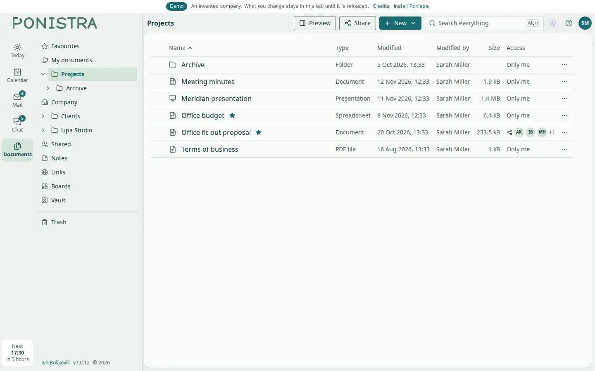
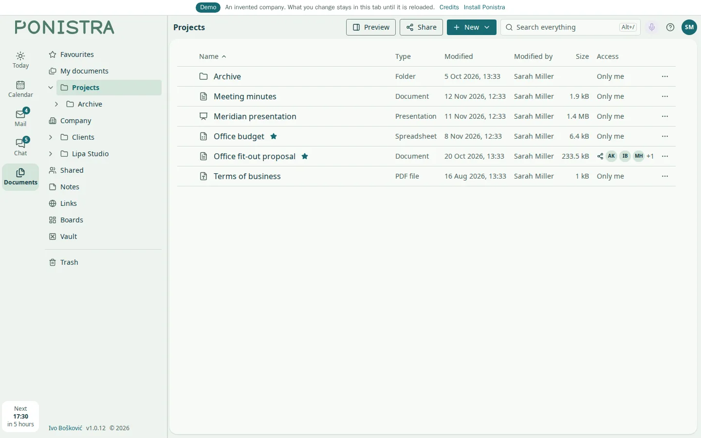
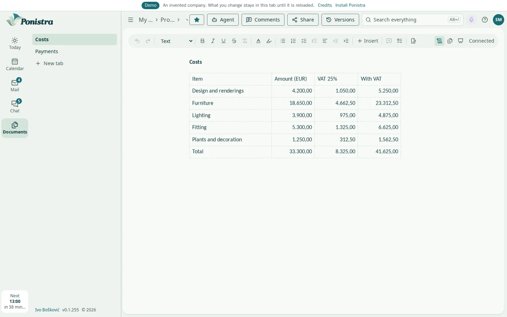
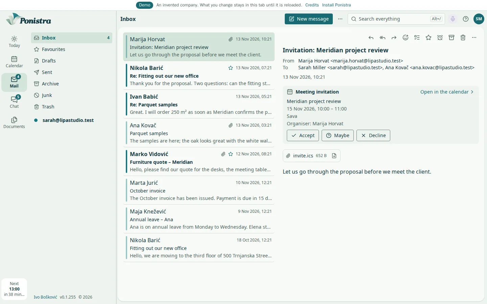
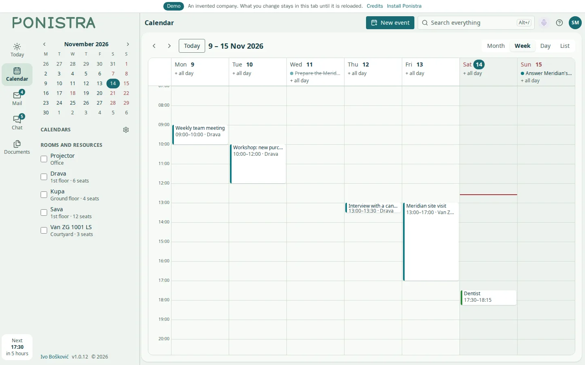

# Ponistra

**An office suite your organisation installs on its own hardware.**

Ponistra is one web application for a firm's everyday work: documents, tables,
presentations and PDF files, and around them mail, a calendar and contacts,
chat and meetings. Everything people write lives in one Postgres database on a
server you own, several people edit the same document at once, and Word, Excel
and PowerPoint files come in and go out as they are. There is no account with
us, no subscription and no cloud of ours in between.

**Try it:** [demo-ponistra.boskovic.biz](https://demo-ponistra.boskovic.biz), the real interface with a made-up company inside.

<p align="center"></p>

<details>
<summary>More screenshots</summary>

**Documents:** text, tables that compute and pictures in one document, edited by several people at once.



**Tables:** formulas worked out on the server, number formats and charts, saved to Excel and back.



**Mail:** the mailboxes people already have, with threads, attachments and one search over all of it.



**Calendar:** every account's calendar in one, invitations, rooms and the free time of colleagues.



</details>

## What it does

A document is text with headings, lists, pictures and tables that compute, in
tabs; it saves as Word, prints to PDF, a table saves as Excel and the headings
make the slides of a presentation. Office files of every common kind come in as
documents, with the original kept beside them. PDF files stay files: viewed,
annotated, searched, and read by OCR where a page carries no text. One search
covers documents, table cells, files, mail, events, people and tasks.

Mail is a client over the mailboxes people already have, by IMAP and SMTP,
ActiveSync, or a Google or Microsoft sign-in: threads, sending later, snoozing,
rules per sender, shared mailboxes, S/MIME and OpenPGP opened and signed in the
browser.
The calendar and the address book gather every account into one and serve a
phone's own apps over CalDAV and CardDAV. Chat, meetings with sound, video and
screen sharing, a recording and minutes, tasks, notes, links and boards share
the same people and the same search.

## What sets it apart

What Office does with dialogs and wizards, Ponistra does as named actions:
carried out by its own code wherever a rule can be written, and by an AI model
only where the task needs language, only after the user agrees, and with the
organisation's own key. Outside agents connect over MCP and act as the user who
let them in, with that user's rights and nothing more; what they write into a
document arrives as proposals the user accepts or rejects.

Formulas are worked out by Ponistra's own engine on the server, held to Excel's
results over a corpus of its files rather than to a guess at them. Every tool,
library and picture inside it carries a permissive licence.

## How it works

The backend is one Django application under uvicorn. A document's content is a
Yjs state per tab in Postgres, with a table of its elements beside it for
search, actions and SQL; edits travel over a WebSocket into rooms inside the
backend, so a change appears on every screen at once. Files are kept by their
SHA-256 in a tree on disk, served with byte ranges. Background work runs in the
same process over Postgres, with no queue or worker of its own.

Work that touches files someone else made runs apart from the backend: a
reader without the database or the secrets opens every foreign file, LibreOffice
converts the older Office formats, Tesseract reads scanned pages, Chromium
prints, and LiveKit carries meetings, each in a container on its own network.
Caddy serves the application and fetches its certificate.

Every night the installation takes a snapshot of the database, the files and
its settings, keeps the database's log for a restore to any moment of the last
seven days, and, once it is set up, sends an encrypted copy to an S3-compatible
bucket of your choice.

## Technology

Python 3.14, Django 6.1 and Postgres 18; React 19, Vite, Tailwind 4 and
TypeScript; ProseMirror and Yjs for editing, pdf.js for PDF, ECharts for
charts. LiveKit for meetings, with a recorder of Ponistra's own in Go. The
Claude API for the actions that need language. Everything runs in containers,
and the Android app is a Trusted Web Activity served by the installation itself.

## Install

Ponistra needs a Linux server with Docker and the Compose v2 plugin, 4 cores,
6 GB of memory and about 5 GB of disk before documents, and a domain that
leads to it.

```bash
mkdir ponistra && cd ponistra
docker run --rm ghcr.io/bacinac/ponistra > ponistra && sh ponistra install
```

The command asks for the domain and for where TLS ends: on this server, where
Caddy fetches the certificate on port 443, or in a proxy or tunnel in front of
it. It generates every secret, starts the stack and prints a one-time code; the
first person to open the address and enter it becomes the administrator.
Meetings, backups, the off-site copy and the rest are in
[docs/INSTALL.md](docs/INSTALL.md).

## Upgrade

```bash
./ponistra update
```

The installation takes a snapshot first; if the new release does not start, it
puts the old one back with the database as the snapshot left it.

## Development

```bash
scripts/install-hooks.sh
mkdir -p volumes/blobs volumes/backup frontend/node_modules
docker compose up -d --build
```

`compose.yaml` is the installation; `compose.override.yaml` lays the
development images over it, built from this tree with the tree mounted. The
interface is on `:5190`, the backend on `:8030`. `scripts/check.sh` runs the
checks and tests in a stack of its own. The public demo is the real interface
over a fictional company held in the browser, see [docs/DEMO.md](docs/DEMO.md).

## License

Ponistra is licensed under [PolyForm Noncommercial 1.0.0](LICENSE.md): free for
personal and non-commercial use. Commercial use requires a separate license;
write to [ivo.boskovic.zg@gmail.com](mailto:ivo.boskovic.zg@gmail.com).
External contributions (pull requests) are not accepted. Third-party material
keeps its own licence, listed in [NOTICE](NOTICE).

Required Notice: Copyright (c) 2026 Ivo Bošković
